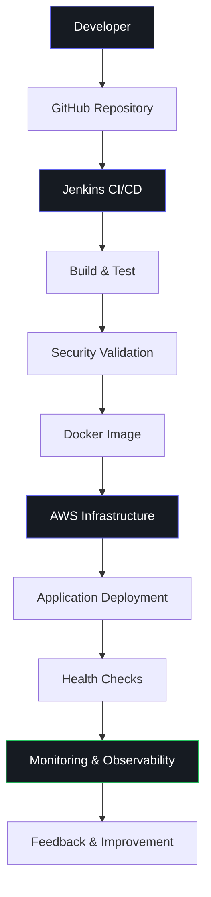

 <div align="center">

# ADITYA CHOURASIYA

### PLATFORM ENGINEERING · SITE RELIABILITY ENGINEERING · CLOUD · AUTOMATION

<p>
  <a href="https://www.linkedin.com/in/aditya-chourasiya-4aa111249"></a>
  <a href="https://github.com/Rightplacecom"></a>
  <a href="mailto:adityalearner6@gmail.com"></a>
</p>


<br>

**Engineering reliable infrastructure. Automating everything repeatable.**

</div>

---

## `01` — ENGINEERING PROFILE

I'm a BCA student focused on **Platform Engineering, Site Reliability Engineering, and Cloud Infrastructure**.

My engineering interests revolve around building reliable infrastructure, automating deployment workflows, container orchestration, and improving system observability.

I approach infrastructure with one objective:

> Make systems reliable, deployments predictable, and engineering workflows repeatable.

```yaml
engineer:
  name: Aditya Chourasiya
  focus:
    - Platform Engineering
    - Site Reliability Engineering
    - Cloud Infrastructure
    - DevOps Automation

  technologies:
    cloud: AWS
    containers: [Docker, Kubernetes]
    iac: Terraform
    cicd: [Jenkins, GitHub Actions]
    monitoring: [Grafana]
    operating_system: Linux
    scripting: [Python, Bash]
```

---

## `02` — ENGINEERING DOMAINS

<table>
<tr>
<td width="50%" valign="top">

### ◈ Platform Engineering

Building infrastructure and workflows that make software delivery easier.

- Internal Developer Platforms
- Infrastructure automation
- Developer self-service concepts
- Standardized deployment workflows
- Container orchestration
- Platform architecture

</td>
<td width="50%" valign="top">

### ◈ Site Reliability Engineering

Understanding and improving the reliability of distributed systems.

- Service health monitoring
- Health-check automation
- Failure detection
- Incident response fundamentals
- Availability and reliability
- Observability

</td>
</tr>
<tr>
<td width="50%" valign="top">

### ◈ Cloud Infrastructure

Provisioning and managing cloud infrastructure.

- AWS EC2
- IAM and access management
- VPC and networking
- Security Groups
- Linux server administration
- Infrastructure as Code

</td>
<td width="50%" valign="top">

### ◈ DevOps & Automation

Automating software delivery from source code to deployment.

- Jenkins pipelines
- CI/CD automation
- Docker image builds
- GitHub integration
- Automated testing workflows
- Deployment validation

</td>
</tr>
</table>

---

## `03` — SELECTED ENGINEERING PROJECTS

<table>
<tr>
<td width="50%" valign="top">

<h3>01. Internal Developer Platform</h3>

<sub>PLATFORM ENGINEERING · IDP · AUTOMATION</sub>

A developer platform focused on simplifying infrastructure workflows and improving developer experience.

**Core engineering**

- Platform architecture
- Developer self-service concepts
- Standardized workflows
- Infrastructure provisioning
- Deployment automation

<br>

<a href="https://github.com/Rightplacecom/Developer-Platform-IDP-"><b>↗ EXPLORE PROJECT</b></a>

</td>
<td width="50%" valign="top">

<h3>02. AWS Jenkins Infrastructure</h3>

<sub>CI/CD · AWS · JENKINS · LINUX</sub>

A cloud-based CI/CD environment using Jenkins controller-agent architecture.

**Core engineering**

- Jenkins controller and agent
- AWS EC2 infrastructure
- Pipeline automation
- GitHub integration
- Docker image builds
- Health-check validation

<br>

<a href="https://github.com/Rightplacecom"><b>↗ EXPLORE REPOSITORIES</b></a>

</td>
</tr>
<tr>
<td width="50%" valign="top">

<h3>03. Terraform Infrastructure</h3>

<sub>IaC · AWS · TERRAFORM</sub>

Infrastructure provisioning and lifecycle management using Terraform.

**Core engineering**

- EC2 provisioning
- Terraform variables
- State management
- Outputs and modules
- Infrastructure lifecycle
- Multi-region concepts

<br>

<a href="https://github.com/Rightplacecom"><b>↗ EXPLORE REPOSITORIES</b></a>

</td>
<td width="50%" valign="top">

<h3>04. Container Engineering</h3>

<sub>DOCKER · KUBERNETES · DEPLOYMENT</sub>

Working with containerized applications and deployment environments.

**Core engineering**

- Docker image creation
- Container lifecycle
- Docker Compose
- Kubernetes fundamentals
- Application packaging
- Container deployment

<br>

<a href="https://github.com/Rightplacecom"><b>↗ EXPLORE REPOSITORIES</b></a>

</td>
</tr>
</table>

---

## `04` — TECHNOLOGY ECOSYSTEM

<div align="center">

### CLOUD & INFRASTRUCTURE


### CONTAINERS & ORCHESTRATION


### CI/CD & VERSION CONTROL


### MONITORING & PROGRAMMING


</div>

---

## `05` — INFRASTRUCTURE LIFECYCLE

<div align="center">



</div>

---

## `06` — SRE ENGINEERING PRINCIPLES

| Principle | Engineering Approach |
|:---|:---|
| Reliability | Design systems to handle failures |
| Availability | Monitor service health and uptime |
| Observability | Understand systems through metrics and logs |
| Automation | Eliminate repetitive manual operations |
| Scalability | Design infrastructure for changing workloads |
| Security | Apply least privilege and secure credentials |
| Recovery | Detect, troubleshoot and recover from failures |

### Reliability mindset

```bash
$ sre --principles

[01] Measure before optimizing
[02] Automate repetitive operations
[03] Monitor critical infrastructure
[04] Detect failures early
[05] Reduce deployment risk
[06] Learn from incidents
```

---

## `07` — CURRENT ENGINEERING FOCUS

- [x] Linux & System Administration
- [x] Docker & Containerization
- [x] Kubernetes Fundamentals
- [x] Jenkins & CI/CD
- [x] Terraform & Infrastructure as Code
- [x] AWS Infrastructure
- [x] Networking Fundamentals
- [ ] Advanced Kubernetes Operations
- [ ] Production Observability
- [ ] SRE Practices & SLO Implementation
- [ ] Advanced Platform Engineering

---

## `08` — GITHUB ANALYTICS

<div align="center">


</div>

---

## `09` — CONNECT

<div align="center">

### BUILD. AUTOMATE. OBSERVE. IMPROVE.

Interested in working on infrastructure, distributed systems, cloud platforms, and reliable engineering solutions.

<a href="https://github.com/Rightplacecom">

</a>

<a href="https://www.linkedin.com/in/aditya-chourasiya-4aa111249">

</a>

<br><br>

<sub>Designed & Engineered by Aditya Chourasiya · 2026</sub>

</div>
